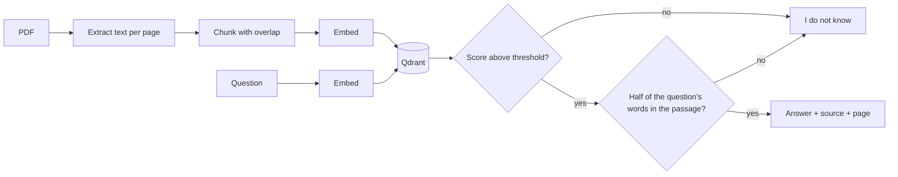

# RAG Document Search

Ask questions about PDF documents. Answers come with page citations, and the system says it does not
know when retrieval finds nothing close enough.

**Status:** small working prototype. It runs locally without any API key or model download. The earlier
public version imported modules that were empty; this version implements them. It has been tested on a
small synthetic corpus only, not on real document collections or at scale.

## How it works



| Part | Default | Optional |
|---|---|---|
| Embeddings | Local character n-gram hashing. Lexical, not semantic. No download. | `sentence-transformers` (`.[semantic]`) |
| Vector store | Qdrant embedded mode | Qdrant server through `QDRANT_URL` |
| Answer | Extractive: sentences from the best chunk, so it cannot invent text | FLAN-T5 generation (`.[generate]`), not evaluated |
| Service | FastAPI with Inngest functions | Streamlit UI (`.[ui]`) |

Non-Latin text works in the default embeddings. Scanned PDFs need OCR first, and the system reports
that rather than indexing nothing.

## Setup

Requires Python 3.11 or newer.

```bash
git clone https://github.com/tahamohmadf19-dev/rag-document-search.git
cd rag-document-search
python -m venv .venv
source .venv/bin/activate      # Windows: .venv\Scripts\activate
pip install -e ".[dev]"
```

## Use it from Python

```python
from rag_core import answer_question, ingest_pdf
from vector_db import QdrantStorage

store = QdrantStorage(location=":memory:")
ingest_pdf("manual.pdf", store)
answer = answer_question("How long is the warranty?", store)
print(answer.text, answer.citations)
```

## Run the UI

```bash
pip install -e ".[ui]"
streamlit run streamlit_app.py
```

## Run the service

```bash
uvicorn main:app --port 8000
npx inngest-cli@latest dev -u http://127.0.0.1:8000/api/inngest
```

Then send the `rag/ingest_pdf` event with `{"pdf_path": "...", "source_id": "..."}`, and `rag/query_pdf_ai`
with `{"question": "...", "top_k": 5}`. The event flow was checked for import and startup only. It has not been
run against a live Inngest dev server.

## Tests and evaluation

```bash
python -m pytest
python evaluation/evaluate.py
```

The tests use real PDF parsing and Qdrant in embedded mode. The evaluation runs on four short documents
written for this purpose (three English, one Arabic), with results in
[evaluation/results.json](evaluation/results.json):

| Measure | Result | Questions |
|---|---:|---:|
| Correct document at rank 1 | 100% | 14 |
| Answer contains the expected fact | 100% | 14 |
| Correctly abstained on unanswerable questions | 5 of 5 | 5 |
| Held-out: answered correctly | 3 of 4 | 4 |
| Held-out: correctly abstained | 4 of 4 | 4 |

**How to read this:** retrieval is easy on such a small, distinct corpus, so the 100% says little about real
collections.

Earlier, 2 of 5 unanswerable questions received an answer: "What is the capital of Australia?" scored 0.238
against a billing policy, above the weakest real answer (0.235), through shared letter patterns alone. No
score threshold separates those. The answer step now also requires at least half of the question's own
content words to appear in the passage. That rule was fixed before measuring, and then checked on 8 held-out
questions written in advance. It rejected all 4 unrelated ones, where the score alone rejected 2. It also
turned away one genuine paraphrase ("library opening hours" against "opens at eight"), which the score alone
had answered. A lexical check cannot recognise paraphrases; semantic embeddings are the next step.

## Limitations

- The default embeddings match wording, not meaning, so paraphrased questions can miss.
- No reranking, hybrid search, or evaluation on real documents.
- Abstention is checked on 8 held-out questions only, not on real documents. Paraphrased questions with few shared words can be refused.
- Not deployed, and not load tested.

## Privacy note

Use sample documents you are allowed to process. Do not commit real personal documents to `uploads/`.
